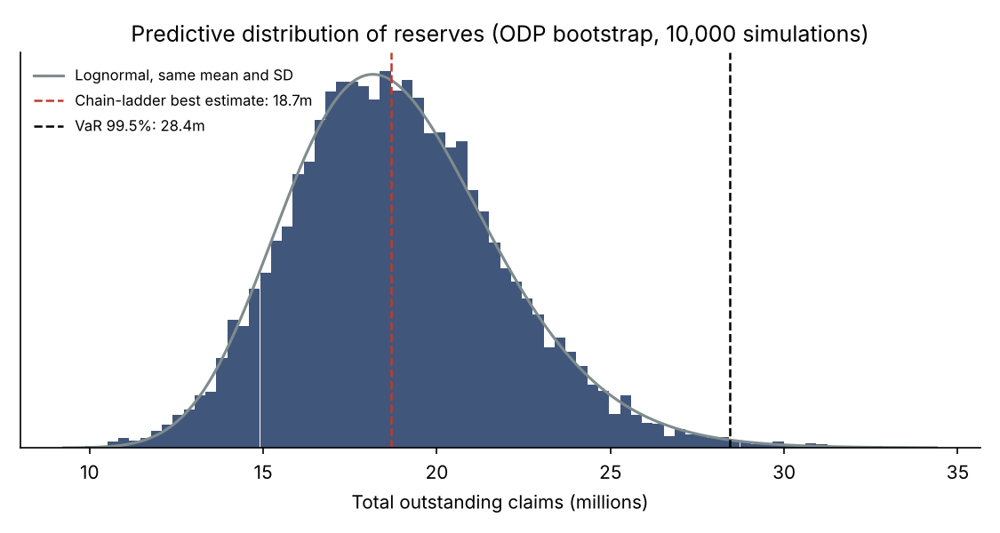
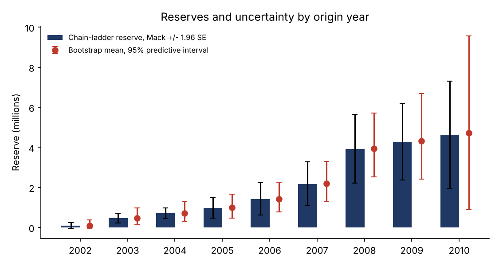
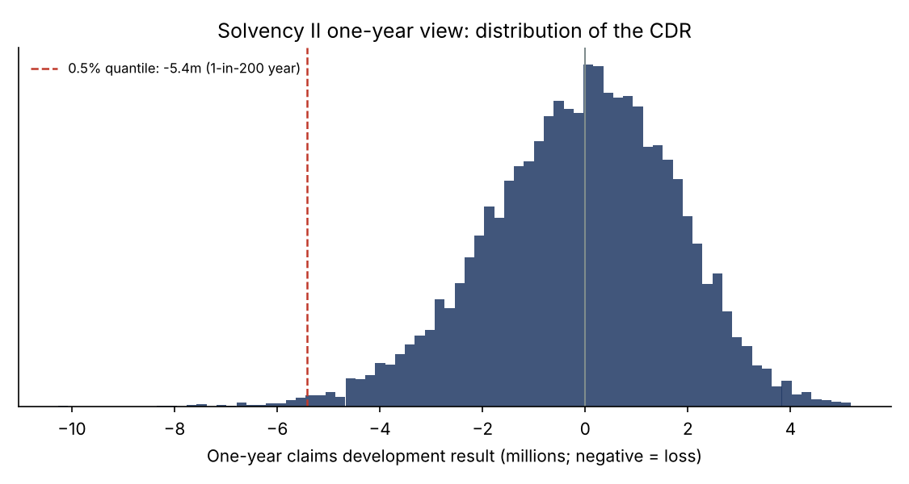
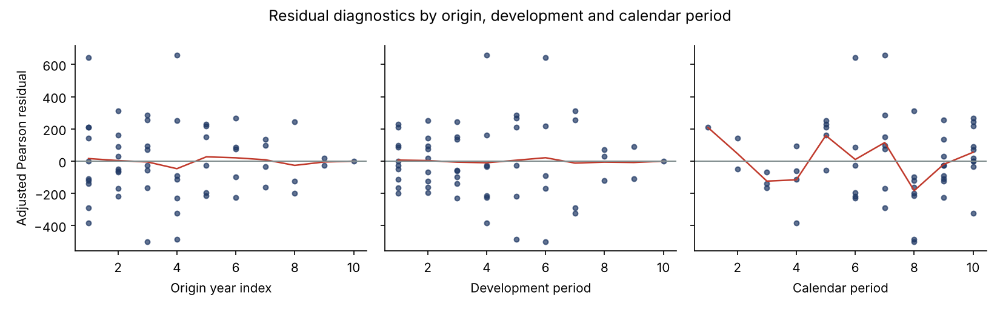

# Stochastic Claims Reserving: Chain-Ladder, Mack, ODP Bootstrap and One-Year Solvency II Risk

A from-scratch Python implementation of the core reserving toolkit used in non-life insurance and reinsurance, applied to the classic Taylor & Ashe (1983) triangle:

1. **Chain-ladder** best estimate of outstanding claims.
2. **Mack (1993)** distribution-free standard errors, split into process and parameter error.
3. **Over-dispersed Poisson bootstrap** (England & Verrall, 2002): the full predictive distribution of reserves.
4. **One-year view** for Solvency II: the distribution of the claims development result (CDR) over the next calendar year, by simulating the next diagonal and re-estimating the chain-ladder ("actuary in the box", Ohlsson & Lauzeningks, 2009).

Every core number is **validated** against the published literature and an independent open-source library.

## Key results

| Metric | Value |
|---|---|
| Chain-ladder reserve | 18,680,856 |
| Mack standard error | 2,447,095 (13.1% of reserve) |
| Bootstrap: mean / standard deviation | 18,882,479 / 3,070,495 (CV 16.3%) |
| Bootstrap: VaR 99.5% / TVaR 99.5% | 28,443,422 / 29,965,017 |
| One-year CDR: standard deviation | 1,839,669 (9.8% of reserve) |
| One-year 1-in-200 loss on the CDR | 5,411,559 (29.0% of reserve) |



**Reading the results.** The ultimate-view uncertainty (CV 16.3%) is much larger than the one-year uncertainty (9.8%): over one year, only part of the run-off risk emerges. This is why Solvency II capital, which is calibrated on a one-year horizon, is lower than a run-off view would suggest. The youngest origin years carry most of the risk: 2010 alone has a 95% predictive interval of 0.9m to 9.6m.



## Validation

| Quantity | This project | `chainladder` library | Published |
|---|---|---|---|
| Chain-ladder total reserve | 18,680,856 | 18,680,856 | 18,680,856 (Mack, 1993) |
| Mack total standard error | 2,447,095 | 2,447,095 | 2,447,095 (Mack, 1993) |
| ODP scale parameter phi | 52,601 | n/a | 52,601 (England & Verrall, 2002) |
| Bootstrap SD, parameter error only | 2,892,321 | 2,780,295 | n/a |

**Two findings from the validation work:**

- **Sigma extrapolation matters.** With its default settings, the library returns a Mack standard error of 2,441,364. The gap comes from how the last variance parameter is extrapolated (log-linear regression by default, versus Mack's original rule). With `sigma_interpolation="mack"`, the library matches this implementation to the unit.
- **Residual adjustment drives parameter error.** The bootstrap parameter error depends on how residuals are corrected for degrees of freedom: raw residuals give about 2.27m, England & Verrall's bias factor (used here) gives 2.89m, and the library's hat-matrix adjustment gives 2.78m. The remaining 4% gap is a method choice, not an error.

An early version of the bootstrap projected future claims from the actual latest diagonal instead of the pseudo-data diagonal. This understated parameter error (SD of 2.15m against about 2.95m in the literature) and was caught by comparing with published results.

## Solvency II reading



| Item | Value |
|---|---|
| One-year sigma (SD of CDR / reserve) | 9.85% |
| Simulated 99.5% reserve risk / reserve | 28.4% |
| 3 x sigma multiplier (standard formula form, with the estimated sigma) | 29.5% |
| Lognormal rho(sigma) | 28.2% |

The Solvency II standard formula sets premium and reserve risk capital at 3 x sigma x volume (Article 115 of Delegated Regulation 2015/35), where sigma is prescribed by line of business. Here, sigma is instead **estimated from this triangle**, in the spirit of an undertaking-specific parameter. The comparison therefore tests whether the 3 x sigma multiplier is a good approximation of the simulated 1-in-200 loss; it is not the standard-formula capital of a real portfolio.

The simulated 1-in-200 reserve risk, measured in excess of the expected CDR, is close to both 3 x sigma and the lognormal quantile function rho(sigma). For this triangle, the 3 x sigma multiplier is a reasonable approximation.

## Method notes

**Chain-ladder.** Volume-weighted development factors:

```math
\hat f_k = \frac{\sum_{i} C_{i,k+1}}{\sum_{i} C_{i,k}}
```

**Mack.** Variance parameters estimated per development period, the last one extrapolated with Mack's rule. Mean squared error of prediction per origin year, plus a covariance term for the total, since all origin years share the same estimated factors.

**ODP bootstrap.** Fitted values are back-cast from the latest diagonal. Adjusted Pearson residuals (bias factor sqrt(n / (n - p)), with n = 55 observations and p = 19 parameters) are resampled to build 10,000 pseudo-triangles. The chain-ladder is refitted on each, and process variance is added with gamma draws of mean m and variance phi x m.

**One-year CDR.** For each simulation, bootstrapped factors generate next year's payments, with gamma process noise. The new diagonal is appended to the actual triangle and the chain-ladder is re-estimated. CDR = R0 - (payments + R1).



Residuals show no trend by origin or development period. The calendar-period panel shows some year-to-year swings without a persistent trend, which would be the first thing to investigate on a real portfolio (claims inflation, changes in claims handling).

## Repository structure

```
├── run_study.py           # runs every method, validation, tables and charts
├── data/
│   └── taylor_ashe_cumulative.csv
├── src/
│   ├── chain_ladder.py    # chain-ladder and Mack, from scratch
│   └── bootstrap.py       # ODP bootstrap and one-year re-reserving
└── results/
    ├── figures/
    ├── tables/
    └── run_log.txt
```

## How to run

```bash
pip install -r requirements.txt
python run_study.py
```

The `chainladder` library is used only to load the public triangle and to cross-check the results; every method is implemented in `src/`.

## Limitations and next steps

- Analytic one-year standard error (Merz & Wüthrich, 2008) to cross-check the simulation: the one-year result is not yet validated against an independent reference.
- Tail factor beyond development period 10, and paid versus incurred comparison (Munich chain-ladder).
- Calendar-year effects: a model with an explicit inflation parameter.
- Several lines of business with dependence (copulas) and diversification of reserve risk.

## References

- Taylor, G. and Ashe, F. (1983). Second moments of estimates of outstanding claims. *Journal of Econometrics*.
- Mack, T. (1993). Distribution-free calculation of the standard error of chain ladder reserve estimates. *ASTIN Bulletin*.
- England, P. and Verrall, R. (2002). Stochastic claims reserving in general insurance. *British Actuarial Journal*.
- Ohlsson, E. and Lauzeningks, J. (2009). The one-year non-life insurance risk. *Insurance: Mathematics and Economics*.

---

**Author:** Yassine El Bakali, MSc in Actuarial Science (ULB) · yelbakali@yahoo.be
